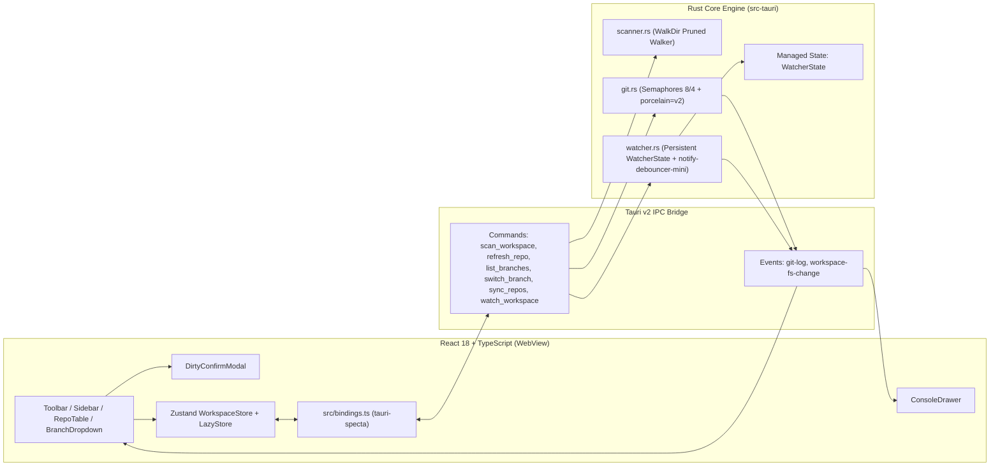
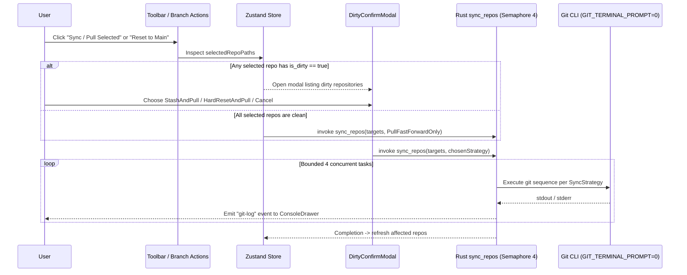

# Mainline — Comprehensive Implementation Plan & Build Guide

> **Source Blueprint**: Synthesized and production-hardened from the [Git Workspace Manager — Phased Implementation Plan & Build Guide](https://docs.google.com/document/d/1vt9NmLuiQfD_3tU86Fm9v-_InKllITgFfdYUyztABog/edit) and aligned with [README.md](../README.md).
> **Critical Corrections**: See [ARCHITECTURE_AND_PITFALLS.md](./ARCHITECTURE_AND_PITFALLS.md) for the 8 defects identified in the original draft and how each is resolved in this plan.

---

## Architecture Overview

**Mainline** is a native-class macOS-style Git Workspace Manager combining a **Rust + Tokio** filesystem/Git engine, a **Tauri v2 + `tauri-specta`** type-safe IPC layer, and a **React 18 + TypeScript + Tailwind CSS + Zustand + TanStack Table/Virtual** frontend.

### Target Capabilities

- **Sub-second workspace scanning**: Scan 500+ nested local Git repositories in `< 1,000ms` via pruned directory walking and bounded async concurrency.
- **Real-time repository telemetry**: Debounced `.git/HEAD` and `.git/index` monitoring across active workspace roots without dropping watcher handles.
- **High-density virtualized UI**: 60 FPS scrolling across 2,000+ repository rows with zero DOM bloat and macOS overlay vibrancy.
- **Safe batch Git execution**: Multi-repo branch reset to default/main branch, fast-forward pulls, fetch-all, and stash-and-pull with mandatory dirty-tree confirmation guardrails.
- **Cross-platform builds**: macOS Universal (`.dmg`), Windows (`.msi`/NSIS), and Linux (`.AppImage`/`.deb`) via GitHub Actions.

### System Architecture & IPC Flow



### Batch Sync & Dirty Guardrail Sequence



---

## Repository Structure (Repo Root)

Scaffold Mainline **directly at the repository root** (`/Mainline`), not inside a nested subfolder:

```text
Mainline/
├── .github/
│   └── workflows/
│       └── release.yml
├── docs/
│   ├── IMPLEMENTATION_PLAN.md
│   └── ARCHITECTURE_AND_PITFALLS.md
├── src-tauri/
│   ├── capabilities/
│   │   └── default.json
│   ├── icons/
│   ├── src/
│   │   ├── commands.rs
│   │   ├── error.rs
│   │   ├── git.rs
│   │   ├── lib.rs
│   │   ├── main.rs
│   │   ├── models.rs
│   │   ├── scanner.rs
│   │   └── watcher.rs
│   ├── build.rs
│   ├── Cargo.toml
│   └── tauri.conf.json
├── src/
│   ├── assets/
│   ├── components/
│   │   ├── BranchDropdown.tsx
│   │   ├── ConsoleDrawer.tsx
│   │   ├── DirtyConfirmModal.tsx
│   │   ├── RepoTable.tsx
│   │   ├── Sidebar.tsx
│   │   └── Toolbar.tsx
│   ├── store/
│   │   └── workspaceStore.ts
│   ├── App.tsx
│   ├── bindings.ts
│   ├── index.html
│   ├── main.tsx
│   └── styles.css
├── package.json
├── postcss.config.js
├── tailwind.config.js
└── tsconfig.json
```

---

## Phase 0 — Project Scaffolding & Configuration

### Step 0.1 — Bootstrap Commands (In Repo Root)

Because `Mainline` already exists as a git repo containing `README.md`, `GEMINI.md`, `AGENTS.md`, `docs/`, and `.agents/`, scaffold without overwriting existing root files (initialize in a temp directory and move template files, or write manifests directly and run `pnpm install`):

```bash
# Install frontend dependencies
pnpm add @tanstack/react-table@^8.15.0 @tanstack/react-virtual@^3.2.0 lucide-react@^0.359.0 zustand@^4.5.2
pnpm add @tauri-apps/api@^2.0.0 @tauri-apps/plugin-dialog@^2.0.0 @tauri-apps/plugin-store@^2.0.0
pnpm add -D @tauri-apps/cli@^2.0.0 @types/node@^20.11.30 @types/react@^18.2.66 @types/react-dom@^18.2.22 @vitejs/plugin-react@^4.2.1 autoprefixer@^10.4.19 postcss@^8.4.38 tailwindcss@^3.4.1 typescript@^5.4.3 vite@^5.1.6

# Initialize Tailwind + PostCSS config
pnpm exec tailwindcss init -p

# Inside src-tauri/
cargo add tauri@2 tauri-plugin-dialog@2 tauri-plugin-store@2
cargo add tokio --features "process sync fs rt-multi-thread time"
cargo add walkdir notify notify-debouncer-mini serde serde_json thiserror
cargo add specta@=2.0.0-rc.20 --features "derive,typescript"
cargo add specta-typescript@=0.0.7
cargo add tauri-specta@=2.0.0-rc.20 --features "derive,typescript"
cargo add --dev tempfile
```

### Step 0.2 — Core Manifests

- **`src-tauri/Cargo.toml`**:
  - Library target: `[lib]` with `name = "git_workspace_manager_lib"` and `crate-type = ["staticlib", "cdylib", "rlib"]`.
  - Dependencies: `tauri = { version = "2.0", features = ["macos-private-api"] }`, `tauri-plugin-dialog = "2.0"`, `tauri-plugin-store = "2.0"`, `tokio = { version = "1.38", features = ["process", "sync", "fs", "rt-multi-thread", "time"] }`, `walkdir = "2.5"`, `notify = "6.1"`, `notify-debouncer-mini = "0.4"`, `serde`, `serde_json`, `thiserror`, `specta = { version = "=2.0.0-rc.20", features = ["derive", "typescript"] }`, `specta-typescript = "=0.0.7"`, `tauri-specta = { version = "=2.0.0-rc.20", features = ["derive", "typescript"] }`.
  - `[dev-dependencies]`: `tempfile = "3.10"`.
  - `[profile.release]`: `panic = "abort"`, `codegen-units = 1`, `lto = true`, `opt-level = "s"`, `strip = true`.
- **`src-tauri/tauri.conf.json`**:
  - `build`: `beforeDevCommand: "pnpm dev"`, `devUrl: "http://localhost:1420"`, `beforeBuildCommand: "pnpm build"`, `frontendDist: "../dist"`.
  - `app.windows[0]`: `"label": "main"`, `"title": "Git Workspace Manager"`, `1280x800` (`minWidth: 1024`, `minHeight: 680`), `"titleBarStyle": "Overlay"`, `"hiddenTitle": true`, `"transparent": true`, `"windowEffects": { "effects": ["sidebar", "vibrancy"] }`.
  - Note: Check `macOSPrivateApi: true` under `app` if needed for transparent vibrancy in Tauri v2.
- **`src-tauri/capabilities/default.json`**:
  - `windows: ["main"]`, `permissions: ["core:default", "dialog:allow-open", "store:default"]`.
- **`package.json`**, **`tsconfig.json`**, **`tailwind.config.js`**, **`postcss.config.js`**:
  - Configure Tailwind `content: ["./index.html", "./src/**/*.{js,ts,jsx,tsx}"]` and `darkMode: "media"` (or `"class"` with OS theme sync).

**Phase 0 Gate**: `cd src-tauri && cargo check` and `pnpm exec tsc --noEmit` succeed on skeleton entry points.

---

## Phase 1 — Core Rust Engine (Scanner & Git Inspector)

### Step 1.1 — Domain Errors & Models (`src-tauri/src/error.rs`, `src-tauri/src/models.rs`)

1. **`error.rs`**:
   - Define `AppError` with `thiserror::Error` and `specta::Type` (or custom `Serialize` + `specta::Type` implementation so `tauri-specta` can export error types cleanly):
     - `Io(String)`
     - `GitExecution { code: i32, message: String }`
     - `ParseError(String)`
     - `InvalidPath(String)`
   - **Important**: Because `#[specta::specta]` commands return `Result<T, AppError>`, `AppError` must derive `serde::Serialize` and `specta::Type` (using `#[derive(Debug, thiserror::Error, Serialize, specta::Type)]` with `#[serde(tag = "type", content = "details")]` or explicit struct fields). Verify `tauri-specta` export compiles cleanly!
2. **`models.rs`**:
   - `GitProvider`: `GitHub`, `GitLab`, `Bitbucket`, `Custom(String)`.
   - `SyncStrategy`:
     - `PullFastForwardOnly`
     - `FetchOnly`
     - `StashAndPull`
     - `HardResetAndPull`
   - `RepoStatus`:
     - `name: String`, `relative_path: String`, `absolute_path: String`
     - `current_branch: String`, `default_branch: String`
     - `ahead_count: u32`, `behind_count: u32` (use `u32` instead of `usize` to avoid BigInt export issues in TypeScript)
     - `is_dirty: bool`, `stashed_count: u32`
     - `remote_url: Option<String>`, `provider: GitProvider`, `is_detached: bool`
     - `last_commit_title: String`, `last_commit_hash: String`, `last_commit_timestamp: f64` (or `i64` with `BigIntExportBehavior::Number` configured in `lib.rs`).
   - `RepoSyncTarget`: `absolute_path: String`, `branch: String`, `reset_to_default: bool` (optional flag for resetting back to `main`/default branch).
   - `LogPayload`: `repo_path: String`, `line: String`, `is_stderr: bool`.

### Step 1.2 — Pruned Directory Walker (`src-tauri/src/scanner.rs`)

- Implement `scan_for_repos(root: &Path, include_submodules: bool) -> Result<Vec<PathBuf>, AppError>`:
  - Validate `if !root.exists() || !root.is_dir() { return Err(AppError::InvalidPath(...)); }`.
  - Prune `PRUNED_DIRECTORIES`: `node_modules`, `target`, `.build`, `.venv`, `venv`, `bin`, `obj`, `.git`, `Pods`, `vendor`, `dist`, `build`.
  - Handle **both** standard `.git` directories and submodule `.git` files (`entry.file_name() == ".git"` when `include_submodules == true`, since Git submodules often store a `.git` file pointing to `.git/modules/...`).
  - When a `.git` directory is matched:
    - Push `parent.to_path_buf()`.
    - If `!include_submodules`, skip descending further into that repository's subdirectories; otherwise skip only `.git` itself (`it.skip_current_dir()` on `.git`).

### Step 1.3 — Async Git CLI Wrapper & Concurrent Inspector (`src-tauri/src/git.rs`)

- `run_git(repo_path: &Path, args: &[&str]) -> Result<String, AppError>`:
  - Uses `tokio::process::Command::new("git")` with `.current_dir(repo_path)` and `.env("GIT_TERMINAL_PROMPT", "0")`.
- `inspect_repo(repo_path: &Path, root: &Path) -> Result<RepoStatus, AppError>`:
  - Resolve `name` and `relative_path` (handle `repo_path == root` by using `"."` or `name`).
  - Detect branch via `git symbolic-ref --short -q HEAD`; if empty/failed, check `git rev-parse --short HEAD` or mark `is_detached = true` and show `"HEAD (<hash>)"` or `"HEAD"`.
  - Detect `remote_url` (`git remote get-url origin`) and map `GitProvider` (`github.com`, `gitlab.com`, `bitbucket.org`, else `Custom`).
  - Detect `default_branch`: try `git symbolic-ref refs/remotes/origin/HEAD`, falling back cleanly to `main` or `master` if `origin/HEAD` is unset locally.
  - Parse `git status --porcelain=v2 --branch`:
    - `# branch.ab +X -Y` -> `ahead_count`, `behind_count`.
    - `# branch.head (detached)` -> sets `is_detached = true` even if repository has unborn or unusual HEAD.
    - Non-`#` lines -> `is_dirty = true`.
  - Count stashes via `git stash list`.
  - Read latest commit via `git log -1 --format=%h|%at|%s`.
- `list_repo_branches(repo_path: &Path) -> Result<Vec<String>, AppError>`:
  - Run `git for-each-ref --format=%(refname:short) refs/heads` for `BranchDropdown.tsx`.
- `inspect_workspace(paths: Vec<PathBuf>, root: &Path) -> Vec<RepoStatus>`:
  - Bounded `Arc::new(Semaphore::new(8))` + `JoinSet` spawning `inspect_repo`, sorted deterministically by `name` / `relative_path`.

### Step 1.4 — Unit & Integration Tests (`src-tauri/src/git.rs` & `scanner.rs`)

- Use `tempfile::TempDir` to test:
  - `test_inspect_clean_repo` (force `-b main` on `git init` so local git config `init.defaultBranch` differences never cause flaky test failures!).
  - `test_inspect_dirty_repo`
  - `test_inspect_detached_head`
  - `test_scan_prunes_node_modules_and_nested_repos`
  - `test_scan_includes_submodules_when_enabled`
  - `test_scan_500_repos_under_1000ms` (gated benchmark test)

**Phase 1 Gate**: `cd src-tauri && cargo test` passes 100%.

---

## Phase 2 — Tauri IPC Bridge & Window Configuration

### Step 2.1 — Tauri Commands (`src-tauri/src/commands.rs`)

Expose `#[tauri::command] #[specta::specta]` handlers:
1. `scan_workspace(app_handle: AppHandle, watcher_state: State<'_, WatcherState>, root_path: String, include_submodules: Option<bool>) -> Result<Vec<RepoStatus>, AppError>`
   - Scans repos, runs `inspect_workspace`, and starts/updates the persistent `WatcherState` for `root_path`.
2. `refresh_repo(repo_path: String, root_path: String) -> Result<RepoStatus, AppError>`
3. `list_branches(repo_path: String) -> Result<Vec<String>, AppError>`
4. `switch_branch(repo_path: String, target_branch: String) -> Result<RepoStatus, AppError>`
   - Checks `is_dirty` or lets Git reject dirty overwrites cleanly, switches branch, and returns refreshed `RepoStatus`.
5. `sync_repos(app_handle: AppHandle, targets: Vec<RepoSyncTarget>, strategy: SyncStrategy) -> Result<(), AppError>`
   - Implemented in Phase 4 with bounded `Semaphore::new(4)` and `git-log` event emission.

### Step 2.2 — `lib.rs` & `main.rs`

- `src-tauri/src/main.rs`: calls `git_workspace_manager_lib::run();`.
- `src-tauri/src/lib.rs`:
  - Initializes `WatcherState::default()` via `.manage(...)`.
  - Collects all 5 commands in `tauri_specta::Builder::<tauri::Wry>::new().commands(tauri_specta::collect_commands![...])`.
  - Exports `../src/bindings.ts` in `#[cfg(debug_assertions)]` using `specta_typescript::Typescript::default().bigint(specta_typescript::BigIntExportBehavior::Number)`.
  - Registers `tauri_plugin_dialog::init()` and `tauri_plugin_store::Builder::default().build()`.

**Phase 2 Gate**: Running `cargo test` or `cargo run` in `src-tauri/` cleanly exports `src/bindings.ts` with zero warnings or BigInt panic.

---

## Phase 3 — macOS-Style React 18 Frontend

### Step 3.1 — State Management (`src/store/workspaceStore.ts`)

- Zustand store backed by `LazyStore('settings.json')`:
  - State: `workspaceRoots`, `activeRoot`, `repositories`, `selectedRepoPaths`, `activeFilter` (`all` | `off-main` | `dirty` | `behind`), `searchQuery`, `isScanning`, `isSyncing`, `isConsoleOpen`, `dirtyModalState` (pending targets + requested operation).
  - Actions: `initStore`, `addWorkspaceRoot`, `removeWorkspaceRoot`, `setActiveRoot`, `scanActiveRoot`, `refreshSingleRepo`, `setRepositories`, `toggleSelectRepo` (supporting single click, `⌘/Ctrl+Click`, and `Shift+Click` range selection), `selectAllVisible`, `clearSelection`, `setFilter`, `setSearchQuery`, `setConsoleOpen`.

### Step 3.2 — UI Components (`src/components/`)

1. **`Toolbar.tsx`**:
   - macOS Overlay titlebar height (`h-12`), `pl-20` clearance for traffic lights, `data-tauri-drag-region` on header and spacers.
   - Controls: **Add Workspace**, **Refresh** (with spinning icon while `isScanning`), **Filter input** (`⌘F` focus shortcut), **Sync Selected / Pull FF**, **Reset to Main**, **Console Drawer toggle**.
2. **`Sidebar.tsx`**:
   - Workspace root list with active selection indicator (clicking switches root and triggers scan + watcher update).
   - Smart filter pills with live counts (`All Repositories`, `Off Main Branch`, `Dirty Working Tree`, `Behind Remote`).
3. **`RepoTable.tsx`**:
   - `@tanstack/react-table` (`getCoreRowModel`, `getSortedRowModel`) + `@tanstack/react-virtual` (`estimateSize: () => 36`, `overscan: 10`).
   - **Aligned Flex Table**: Both `<thead>` `<tr>` and virtualized `<tbody>` `<tr>` share explicit flex/width column classes (`flex-[2]`, `flex-[1.2]`, `w-32`, `w-28`, `w-32`) so headers align cleanly with absolute-positioned virtual rows.
   - Columns: Checkbox/Selection, Repository (`name` + `relative_path`), Branch (`BranchDropdown`), Working Tree Status (`Clean` / `Uncommitted` + stash badge), Sync State (`ahead` / `behind` / `Synced`), Last Commit (`last_commit_hash` + `last_commit_title`).
4. **`BranchDropdown.tsx`**:
   - Lazy-loads branches on click via `commands.listBranches(repo.absolute_path)`.
   - Invokes `commands.switchBranch` or surfaces dirty-tree guardrails if working tree has uncommitted modifications.
5. **`ConsoleDrawer.tsx`**:
   - `export const ConsoleDrawer: React.FC` subscribing to `listen<LogPayload>('git-log', ...)` with bounded ring buffer (`slice(-200)`), auto-scroll, and Clear button.
6. **`App.tsx` + `main.tsx` + `styles.css`**:
   - Hydrates `initStore()`, auto-scans `activeRoot`, binds `⌘F` keyboard shortcut to search input, listens to `workspace-fs-change` (with debounced single-repo `refreshRepo` resolution from changed path), and renders `DirtyConfirmModal`.

**Phase 3 Gate**: `pnpm exec tsc --noEmit && pnpm build` succeeds with zero TypeScript or bundler errors.

---

## Phase 4 — Batch Sync Operations & Safety Guardrails

### Step 4.1 — Rust Sync Pipeline (`src-tauri/src/commands.rs`)

Implement `sync_repos` with `Arc::new(Semaphore::new(4))` and full `SyncStrategy` execution:
- **`PullFastForwardOnly`**:
  - If `target.reset_to_default`, checkout `target.branch` first (`git checkout <branch>`).
  - Run `git pull --ff-only`.
- **`FetchOnly`**:
  - Run `git fetch --all --prune`.
- **`StashAndPull`**:
  - Run `git stash push --include-untracked -m "Mainline auto-stash"`.
  - If `target.reset_to_default`, checkout `target.branch`.
  - Run `git pull --ff-only`.
  - Run `git stash pop` (only if a stash entry was created; emit clear stderr warning if pop hits a conflict).
- **`HardResetAndPull`**:
  - Run `git reset --hard HEAD` and `git clean -fd`.
  - If `target.reset_to_default`, checkout `target.branch`.
  - Run `git pull --ff-only`.
- Stream every step's stdout/stderr as `LogPayload` events (`"git-log"`), then refresh repository statuses on the frontend.

### Step 4.2 — Pre-Flight Checks & `DirtyConfirmModal.tsx`

- Before calling `sync_repos`, filter selected repos where `repo.is_dirty == true`.
- If any are dirty, halt and open `DirtyConfirmModal`:
  - **"Stash Changes, Pull & Re-apply"** -> calls `onConfirm('StashAndPull')`.
  - **"Hard Reset (Discard All Changes)"** -> calls `onConfirm('HardResetAndPull')` (plus optional second confirmation or explicit warning badge).
  - **"Skip Dirty Repositories"** -> syncs only clean repos with `'PullFastForwardOnly'`.
  - **"Cancel Operation"** -> aborts completely.

**Phase 4 Gate**: Dirty repositories never receive `reset --hard` or `pull` without modal confirmation; `StashAndPull` preserves and re-applies uncommitted edits in tests.

---

## Phase 5 — Persistent Filesystem Watching & Multi-Platform Release

### Step 5.1 — Persistent Watcher (`src-tauri/src/watcher.rs`)

- Define `pub struct WatcherState(pub Mutex<Option<Debouncer<RecommendedWatcher>>>);`.
- Implement `start_workspace_watcher(state: &WatcherState, app_handle: AppHandle, root_path: &Path) -> Result<(), AppError>`:
  - Creates a `250ms` `new_debouncer(...)` watching `root_path` recursively.
  - Filters events strictly to `.git/HEAD` and `.git/index` changes (checking path components so normal project `index.ts` or `index.html` files do **not** trigger false refreshes!).
  - Emits `"workspace-fs-change"` with the repository root or changed path.
  - Replaces the old debouncer inside `WatcherState` (`*guard = Some(debouncer)`), keeping the watcher alive for the lifetime of the active root.

### Step 5.2 — CI/CD Pipeline (`.github/workflows/release.yml`)

- Trigger on tags `v*`.
- Matrix across `macos-latest` (`aarch64-apple-darwin,x86_64-apple-darwin`), `ubuntu-latest` (with WebKitGTK/GTK3/libayatana dependencies), and `windows-latest`.
- Build with `pnpm/action-setup`, `dtolnay/rust-toolchain@stable`, and `tauri-apps/tauri-action@v2` producing draft release artifacts (`.dmg`, `.msi`, `.AppImage`/`.deb`).

---

## Phase 6 — Verification & Acceptance Testing Matrix

| Category | Test Case | Target Metric / Acceptance Criteria | Verification Method |
| :--- | :--- | :--- | :--- |
| Performance | Cold Initial Scan | Scan 500 local repositories in `< 1,000ms`. | Benchmark test / `generate_benchmark_repos.sh` |
| UI Performance | Dynamic UI Virtualization | Maintain 60 FPS scrolling with 2,000 active table items. | `@tanstack/react-virtual` Chrome DevTools frame trace |
| Resource Budget | Memory Footprint | Backend + Frontend baseline RSS `< 120MB` on macOS. | macOS Activity Monitor / `ps -o rss` |
| Git Edge Cases | Concurrent Submodule Handling | Process repos with submodules accurately (`include_submodules`). | Rust integration test with nested submodule fixture |
| Git Edge Cases | Detached HEAD Resolution | Status parser flags `is_detached = true` for non-symbolic HEAD. | Rust integration test checking out commit SHA |
| Concurrency | Bounded Threading | Inspection caps at 8 workers; batch sync caps at 4 workers. | `Semaphore` configuration + stress test |
| Safety | Destructive Action Intercept | Dirty repos trigger `DirtyConfirmModal` before hard reset/pull. | Frontend state & modal interaction test |
| Reactivity | Live Realtime Debouncing | Multi-file burst edits trigger 1 consolidated refresh (`250ms`). | Integration check on `watcher.rs` |
| Delivery | Target Build Packaging | Deliver macOS (`.dmg`), Windows (`.msi`), Linux (`.AppImage`). | GitHub Actions `release.yml` matrix |
